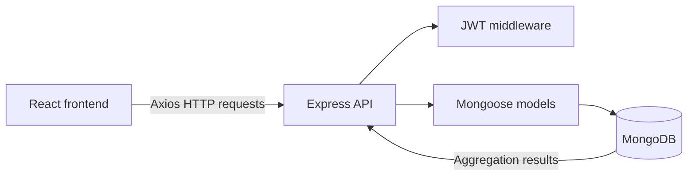

# Personal Expense Tracker

A full-stack expense management application built with **React**, **Node.js / Express**, and **MongoDB**. Users can register, sign in, record daily spending, and view monthly totals grouped by category.

Developed by **Abdallah Namoura** for the **Database II Lab**, Faculty of Dual Studies, Department of Information Technology, Al-Quds University (24 May 2025).

## Project Overview

The project demonstrates how a document database supports a practical application: user accounts and expense records are stored in MongoDB, an Express API handles queries and updates, and a React interface presents the results.

The focus is on connecting frontend forms, authenticated API requests, persistent storage, and aggregation reports in one application.

## Features

- **User accounts:** registration with bcrypt password hashing and login with JSON Web Tokens (JWTs).
- **Expense entry:** add an amount, category, and optional description; the database supplies a date when none is provided.
- **Expense management:** list and delete records through the main interface.
- **Monthly summaries:** aggregate spending by year, month, and category.
- **API queries:** filter expenses by category and date range, and update existing records through the API.
- **Session controls:** explicit logout and a browser-close cleanup handler.

The main interface offers six categories: food, transport, clothes, entertainment, utilities, and others. Editing and date/category filtering are implemented in the API; the main interface does not currently expose those controls.

## Architecture



The React application stores the login token in local storage and sends it in the `Authorization: Bearer <token>` header. Protected endpoints use the token's user ID to scope queries. MongoDB's aggregation pipeline produces the summary table.

## Database Design

| Collection / model | Fields | Purpose |
| --- | --- | --- |
| `User` | `email`, `password` | Unique email address and bcrypt password hash. |
| `Expense` | `userId`, `amount`, `category`, `date`, `description` | Spending record associated with a user. |

The expense model stores `userId` as a string. The summary pipeline matches the current user, groups records by year/month/category, sums `amount`, and sorts the grouped results chronologically and by category.

Implementation: [user model](backend/models/user.js), [expense model](backend/models/expense.js), and [expense routes](backend/routes/expenseroutes.js).

## Getting Started

### Requirements

- Node.js and npm (Node.js 22 was used for repository preparation).
- A running local MongoDB instance or a MongoDB Atlas connection string.
- Two terminals for the backend and frontend.

### 1. Clone the Repository

```bash
git clone https://github.com/a-namoura/expense-tracker.git
cd expense-tracker
```

### 2. Configure the Backend

Copy `backend/.env.example` to `backend/.env`. In PowerShell:

```powershell
Copy-Item backend/.env.example backend/.env
```

On macOS/Linux, use `cp backend/.env.example backend/.env`.

| Variable | Description |
| --- | --- |
| `MONGO_URI` | Your MongoDB connection URI. The example uses a local `expense-tracker` database. |
| `JWT_SECRET` | A long, randomly generated signing secret. Replace the example placeholder. |
| `PORT` | Backend port; defaults to `5000`. |

Generate a secret locally with:

```bash
node -e "console.log(require('crypto').randomBytes(48).toString('hex'))"
```

Keep actual credentials in `backend/.env`. Environment files, private keys, credential files, dependencies, build output, and local database files are excluded by the root `.gitignore`. The example file contains placeholders only. Ignore rules do not remove secrets already tracked in Git or detect credentials written directly into source code.

### 3. Start the Backend

```bash
cd backend
npm ci
npm start
```

For automatic restarts during development, use `npm run dev`.

### 4. Start the Frontend

In a second terminal, from the repository root:

```bash
cd frontend
npm ci
npm start
```

Open **http://localhost:3000**. The frontend currently calls **http://localhost:5000** directly; keep the backend on port `5000` unless you update those URLs in the client components.

### 5. Use the Application

1. Register an account, then log in.
2. Select a category and enter a positive expense amount.
3. Add an optional description and submit the expense.
4. Use **View Summary** to inspect totals by month and category.
5. Delete an expense from the list or log out when finished.

## API Reference

All paths below are relative to `http://localhost:5000`.

| Method | Endpoint | Behavior | Authentication |
| --- | --- | --- | --- |
| `POST` | `/api/auth/register` | Register using `email` and `password`. | Public |
| `POST` | `/api/auth/login` | Return a JWT valid for one day. | Public |
| `GET` | `/api/expenses` | List expenses; optional `category`, `startDate`, `endDate` query parameters. | Bearer token |
| `POST` | `/api/expenses` | Create an expense. | Bearer token |
| `PUT` | `/api/expenses/:id` | Update an expense belonging to the current user. | Bearer token |
| `DELETE` | `/api/expenses/:id` | Delete an expense by ID. | Currently unprotected; see limitations below. |
| `GET` | `/api/expenses/summary` | Return totals grouped by year, month, and category. | Bearer token |
| `POST` | `/api/logout` | Acknowledge a browser-close notification. | Public |

Example expense body:

```json
{
  "amount": 8.65,
  "category": "food",
  "description": "Lunch",
  "date": "2025-05-24"
}
```

## Repository Contents

```text
backend/
  middleware/auth.js         JWT verification
  models/                    User and expense schemas
  routes/                    Authentication and expense endpoints
  .env.example               Safe configuration template
  server.js                  Express server and MongoDB connection
frontend/
  public/                    Static application assets
  src/components/            Login, registration, expense, and summary views
  src/App.js                 Main interface and view switching
  app.js                     Earlier standalone interface implementation
.gitignore                   Confidential and generated file exclusions
README.md                    Project documentation
```

The original lab report is retained locally and excluded from publication because it contains a screenshot of a stored password hash. The active frontend entry point is `frontend/src/index.js`; `frontend/app.js` is not the running application's entry point.

## Validation and Limitations

The backend package declares the authentication dependencies used by its source (`bcryptjs` and `jsonwebtoken`). JavaScript syntax and install/build checks can be run separately from database-backed workflows:

```bash
node --check backend/server.js
cd frontend
npm run build
```

There is no implemented backend test suite. The frontend's existing `App.test.js` is the original Create React App placeholder and does not test the expense tracker; it should be replaced before relying on `npm test` for regression coverage.

This is an educational project. Before deploying it or storing sensitive financial data, address these implementation gaps:

- Protect the delete endpoint with authentication and an ownership check.
- Add consistent server-side validation and registration error handling.
- Revisit token storage and logout: removing a browser token does not revoke an issued JWT, and browser-close cleanup is not guaranteed.
- Restrict CORS and review the older frontend build dependencies.
- Integrate editing and filtering into the active UI; the separate filter component currently targets a different endpoint.

## Future Enhancements

Potential extensions include expense editing in the interface, date/category filters, charts, multiple currencies, notifications, and profile management.

### Repository Preparation Checks

- Backend JavaScript syntax checks passed, and the missing authentication dependencies were installed.
- Frontend installation with `npm ci` completed successfully.
- The frontend production build fails on Node.js 22 with `ERR_OSSL_EVP_UNSUPPORTED` in the existing Webpack toolchain. The frontend tooling needs modernization before the build can be treated as verified on current Node.js versions.
- Database-backed registration, login, and expense flows were not exercised during repository preparation.
